# Tidebound

NeoForge 1.21.1 mod: an endless ocean with far-flung islands. Every island is guarded by a miniboss; beat it to loot the island. You sail between them on a **Sable physics ship** that you can build on freely (same engine as Let it Walk! mechs), and grow it with premade upgrades at the **Ship Core**.

Requires **Sable 2.0.x** (NeoForge 1.21.1). Works alongside Create, Let it Walk!, etc.

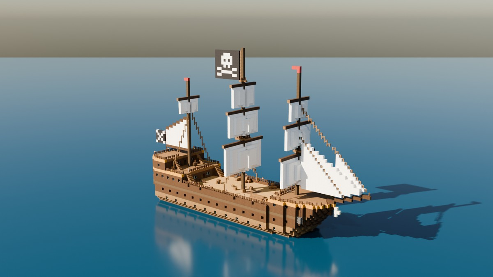

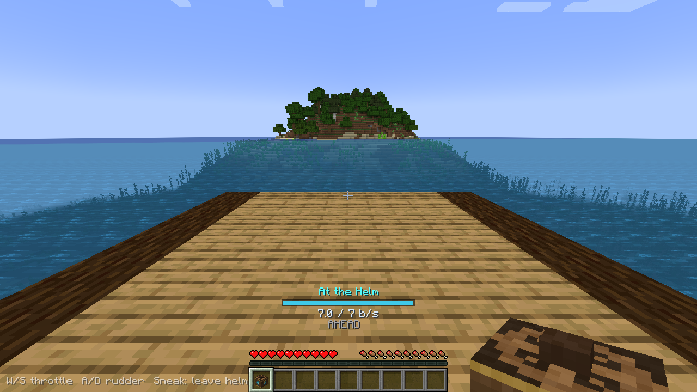

## World

- New worlds ("Default" world type) are the archipelago. It's ~99% ocean (deep, 22-40 blocks down to the seabed) with one island per 1000x1000 cell.
- Islands are **50-150 blocks across**, with noisy coastlines and beaches. Each has one land biome (forest, taiga, jungle, cherry grove, savanna, dark forest, snowy taiga, meadow...), so trees, ores, villages and other vanilla features generate on them as usual.
- Islands are always **at least ~450 blocks apart** coast to coast, usually 600-1000.
- You spawn on the **Home Isle** at 0,0. It has no guardian, so you can loot it right away. On your first join you get a Ship Core.

| Home Isle | A guarded island |
|---|---|
| 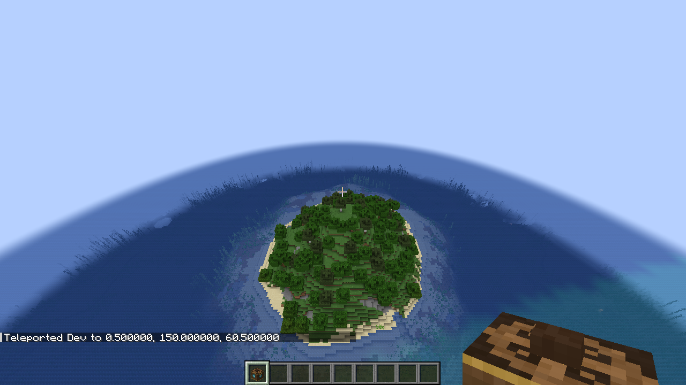 | 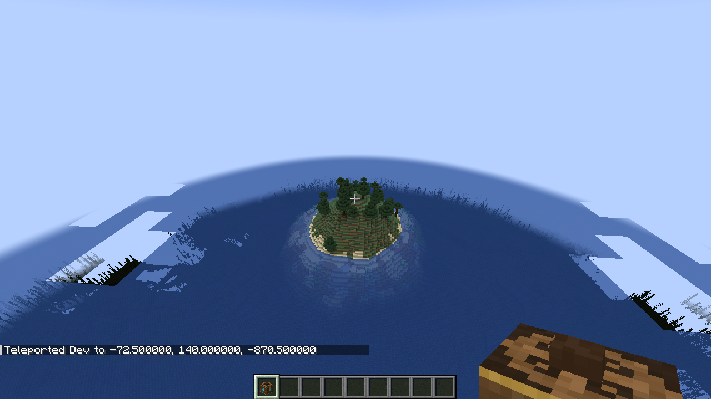 |

## Guardians and loot

- When you come within ~48 blocks of an island's coast, its guardian wakes up. Guardians are giant buffed mobs with a boss bar and abilities:
  - **Hollow King**: wither skeleton, ground slam, summons skeletons
  - **Thornback**: ravager, leaps, summons vindicators
  - **Tidecaller**: drowned with a trident, calls lightning on you, summons drowned
  - **Broodmother**: giant spider, leaps, summons cave spiders
  - **Hexweaver**: evoker, uses its own fangs and vexes, summons vindicators
  - **Grave Titan**: husk with an axe, ground slam, leaps, summons husks
- Below 35% health they **enrage**: faster, and their abilities come twice as often.
- Guardians stay on their island and are immune to fire, sunlight, falling, drowning, their own lightning and their minions.
- While the guardian lives, **the island is protected**: you can't break its blocks, and explosions don't touch it. You can still place blocks to pillar or bridge during the fight.
- When the guardian dies, the island is freed (title + chat). A **loot cache** chest appears with logs (matching the island's trees), cobblestone, iron, copper, coal, wool, string, glass, food, sometimes gold, iron blocks or diamonds, and **Tide Shards**. After that you can mine and chop the whole island.

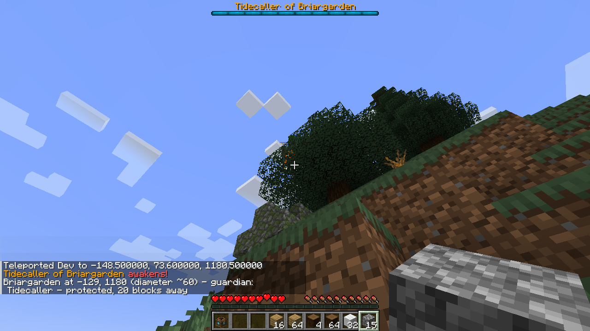

## Ships

- **Ship Core** used on open water builds a 7x11 raft with the core on it, already floating.
- Or place the core on your own hull (built on water or on a slipway) and press **Launch Ship** in the core screen. Everything connected to it, except terrain, becomes the ship (max 20000 blocks).
- It's a real Sable rigid body. You can walk on it, **place and break blocks on it while it sails**, put chests and machines on it, and bring a Let it Walk! mech aboard.
- **Buoyancy** comes from the hull envelope: every column from its lowest to its highest block displaces water, so enclosed air floats a ship like a real boat. Heavy builds sit deeper. Water drag, a keel-direction resistance and a stabiliser keep it upright.
- The starter raft needs at least 4 blocks of water under it, so launch it away from the beach. A ship that runs aground tells you so at the helm; back off with S.
- **Moving the helm:** break the Ship Core and place one anywhere else on the ship. The ship remembers its upgrades and keeps building them where they belong (around the first core's spot, facing the ship's original bow), and the core you take the helm at is the one that steers. Extra cores on the same ship are spares.
- Launching never takes water, bubble columns, kelp, seagrass, coral or magma with the ship.
- **Right-click the core → Take the Helm.** Taking the helm turns off creative flight so the ship carries you (a flying pilot would be left behind). W/S = throttle ahead/astern, A/D = rudder, Sneak = let go. You can take the helm from anywhere within 8 blocks of the core (the cabin roof gives a clear view past the mast). A HUD shows speed, and with the Crow's Nest it also points to the nearest unclaimed island.

### Upgrades (premade, built onto your ship at the core)

Each upgrade builds its layout around the core. It never replaces blocks you placed; it only rebuilds untouched blocks from the raft or earlier upgrades (the full hull takes in the starter raft, for example). The finished ship is about 48 blocks long with the bowsprit and 19 wide across the paddle boxes, so build it out in open water.

| Preview | Upgrade | Needs | Effect | Cost |
|---|---|---|---|---|
| 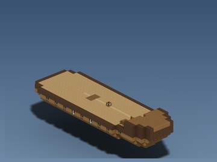 | Expanded Hull | - | A 41-block ship's hull: tapered bow, raised forecastle, cargo hatch, portholes, and a **furnished lower deck** (see below) | 128 planks, 32 logs |
| 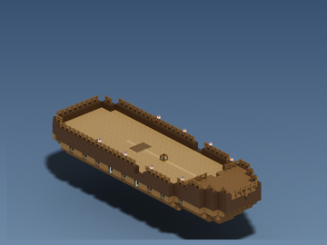 | Gunwales | Expanded Hull | Bulwarks and rails all round, lanterns on the rail posts, boarding gaps | 48 planks, 24 sticks |
| 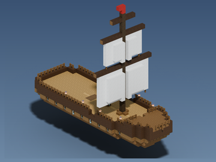 | Mainmast & Sail | Expanded Hull | 26-block mainmast with course and topsail, pennant, **+5 speed** | 32 logs, 48 wool, 1 shard |
|  | Keel & Rudder | Expanded Hull | Keel, stem post and rudder, **x1.6 turning, x2 stability** | 24 logs, 12 iron, 1 shard |
| 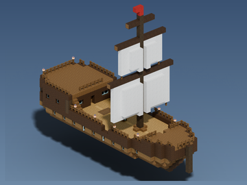 | Captain's Cabin | Expanded Hull | Stern cabin with windows, door and furniture; quarterdeck on top with stairs and stern lanterns | 128 planks, 8 glass, 4 iron, 2 shards |
| 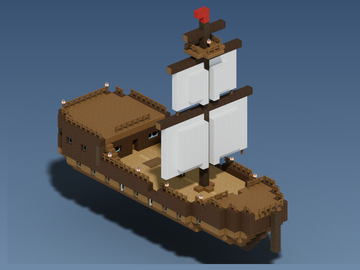 | Crow's Nest | Mainmast | Lookout platform with a ladder up the mast, **island locator on the HUD** | 24 planks, 8 logs, 1 shard |
|  | Foremast & Jib | Expanded Hull, Mainmast | Foremast with two sails, bowsprit and jib, **+4 speed** | 24 logs, 32 wool, 2 shards |
| 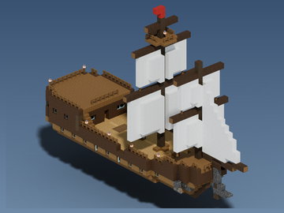 | Iron Prow | Expanded Hull | Waterline ram, sheathed cutwater and two anchors, **+2 speed, steadier** | 16 iron, 8 iron bars, 16 cobblestone, 2 shards |
| 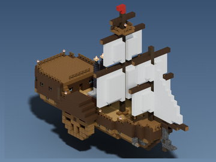 | Paddle Steamer | Keel, Cabin | Paddle wheels in arched boxes, boiler house and twin smoking funnels, **+8 speed, x1.8 acceleration** | 32 iron, 16 copper, 48 cobblestone, 4 shards |
| 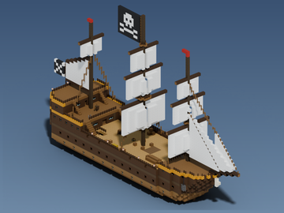 | **The Galleon** | all of the above | The final upgrade: rebuilds the ship as a three-decked pirate galleon (see below), **+3 speed, x1.5 stability** | 640 planks, 192 logs, 160 wool, 12 shards |

Raft top speed is 7 blocks/s; with every upgrade up to the Paddle Steamer about 25 blocks/s, and the Galleon about 28.

### The lower deck

Expanded Hull also builds a whole deck inside the hull, so the top deck can stay open. Take the stairs down on the starboard side, forward of the mainmast: crew quarters with six bunks and sea chests at the stern, a mess table with chairs under the cargo hatch, a galley (furnace, smoker, water cauldron, brewing stand), the foot of the mainmast, and a cargo hold of chests and barrels at the bow. Portholes along both sides let daylight in, and hanging lanterns keep mobs from spawning.
 Each preview shows the ship with that upgrade and the ones above it. Hover an upgrade in the Ship Core screen to see the same preview in game.

The layouts are generated by `python tools/ship_design.py` (writes `data/tidebound/ship_blueprints/*.json`, which the mod loads, and `run/design_preview.json`). The previews are rendered in Blender (Cycles) from those exact blocks, with the game's own block models and textures: `blender -b --factory-startup --python tools/render/render_presets.py -- run/design_preview.json docs/images/presets`, (also renders `lower_deck.png`, the cutaway), then `python tools/render/make_images.py` for the in-game previews and README cards (needs the vanilla assets unzipped from the 1.21.1 client jar into `tools/render/mc`).

| Ship Core | Upgraded ship |
|---|---|
| 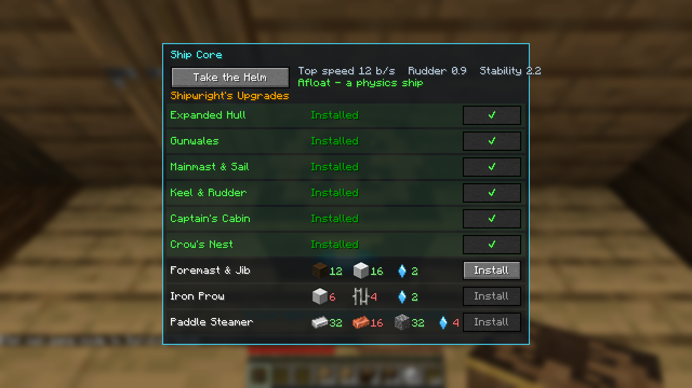 | 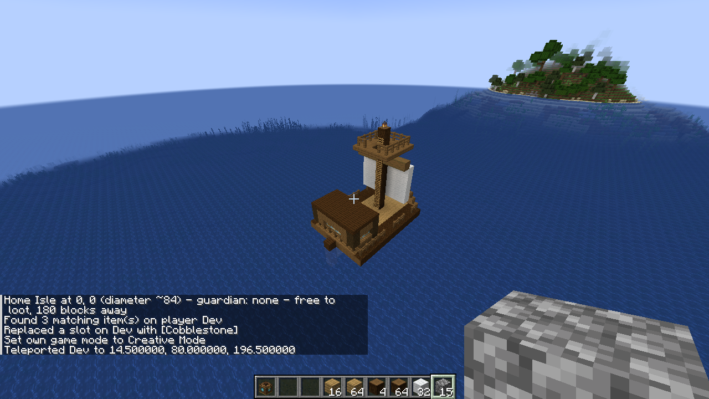 |

Extra cores: craft with planks, logs, a compass and a Tide Shard.

## The deep (client)

Underwater, the deeper you are the darker it gets: the fog closes in and turns black, down to a few blocks of sight ~30 blocks under the surface. Past ~14 blocks deep a weak, **dying head lamp** clicks on: a dim, wavering beam that stutters and sometimes cuts out for a second or two, so you can just make out what's ahead. Conduit Power or Night Vision keeps the deep lit. It is part of the mod (not a shader pack), so it works with Sodium and changes nothing else about the graphics.

## Modpack

`dist/Tidebound-1.0.0.mrpack` (Modrinth format, NeoForge 21.1.266, MC 1.21.1). Drag it into the Modrinth App, or import it in Prism/ATLauncher. Tidebound itself is bundled; everything else downloads from Modrinth:

- **Ships**: Sable, Create, Create Aeronautics (with Simulated and Offroad), Create Propulsion: Simulated, Create Big Cannons
- **Exploring**: Xaero's Minimap + World Map, JEI, Jade, AppleSkin
- **Life at sea**: Farmer's Delight, Aquaculture 2, Supplementaries, Comforts (hammocks)
- **Performance**: Sodium, ModernFix, FerriteCore, EntityCulling, ImmediatelyFast

Rebuild: `cd modpack && python resolve.py mods.txt resolved.json && python build.py resolved.json ../dist/tidebound-1.21.1-neoforge-1.0.0.jar ../dist/Tidebound-1.0.0.mrpack cache`. Let it Walk! and Sable Photomancy are left out because they (or LDLib2) aren't on Modrinth.

## Updates

Tidebound updates itself. At startup it checks the latest release on [GitHub](https://github.com/EEEEE213/tidebound/releases); if it's newer, it downloads the jar into your mods folder and tells you in chat. The new version runs from your next launch. To turn it off, set `enabled=false` in `config/tidebound-updater.properties`.

Publishing an update: `sh tools/release.sh <version> "notes"` (bumps the version, builds, commits, tags, pushes and creates the GitHub release with the jar and the .mrpack).

## The Galleon

The final upgrade turns your ship into a 77-block pirate galleon (about 90 with the bowsprit), 21 wide, with three masts up to 50 blocks tall and the Jolly Roger at the main masthead. It replaces the earlier premade parts with one coherent design; blocks you placed yourself, and any chest or barrel with items in it, are left alone.

- **Main deck:** bulwarks with 8 deck guns, cargo gratings, a capstan, the ship's boat, stairs up to both castles.
- **Stern castle:** the captain's great cabin (stern windows, bed, chart table, bookshelves), two officers' cabins, the quarterdeck with the ship's wheel and bell, and a chart room under the poop deck with stern lanterns and a black ensign.
- **Forecastle:** the galley underneath (furnaces, smokers, cauldrons), the ship's bell, anchors, bowsprit and two jibs, and a bone figurehead.
- **Gun deck:** 30 cannons at their ports, bunks and sea chests between the guns, two mess tables, the capstan, a carpenter's corner and the sick bay.
- **Orlop:** provisions, a strongroom, the cargo hold, the armory and the brig.

Its hull trims itself to float with the water under the orlop floor, so all three decks stay dry, and it keeps an even keel at full speed.

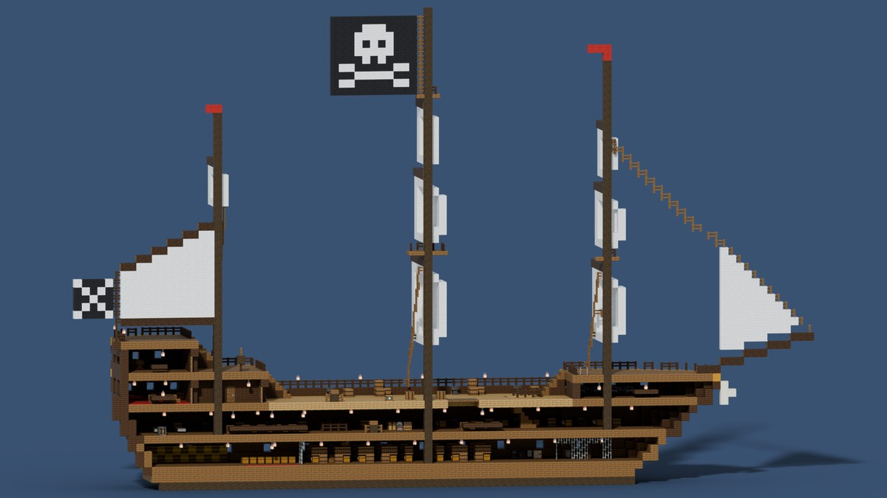

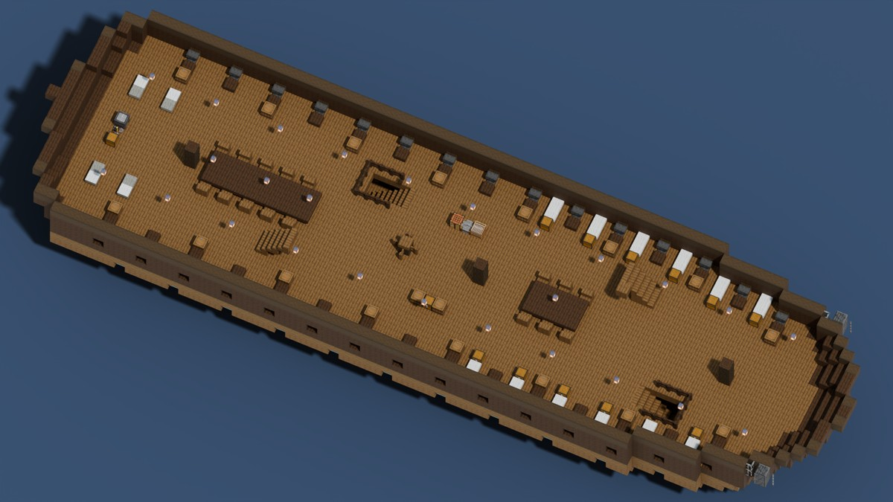

## Commands

- `/tidebound island`: the nearest island, its guardian, and whether it's freed
- `/tidebound nearest`: the nearest unclaimed island
- `/tidebound free`, `/tidebound goto` (op): free the nearest island / teleport off the coast of the next one

## Notes

- Tidebound sets Sable's `universal_drag` to 0 in the Overworld (`data/tidebound/dimension_physics/overworld.json`), and ships cancel Sable's built-in body damping (measured live per ship) while afloat. Without this, no hull could go faster than ~2 blocks/s, and fast ships nosed under. Other Sable bodies in the Overworld therefore feel less air drag.
- Existing worlds keep their generator. Only new "Default" worlds become archipelagos (the `tidebound:archipelago` world preset is also available).

## Development

- Build: `./gradle.sh build` (cached Gradle 8.14.3, Gradle home on E:). Jar: `dist/`.
- Unit tests: `./gradle.sh test` (island layout: sizes, spacing, land fraction).
- Game tests: `rm -rf run/world && ./gradle.sh runGameTestServer`. Covers the raft floating, sailing, turning and taking every upgrade; a guardian dying and freeing its island with loot; and a damping probe.
- Scripted client (hidden window, muted): `tools/autotest/run.sh tools/autotest/<tour|islands|persist>.txt <log>`. Screenshots go to `run-client/screenshots`.
- Worldgen JSON and assets are generated: `python tools/gen_worldgen.py <vanilla overworld.json> .`, `python tools/gen_assets.py .`
